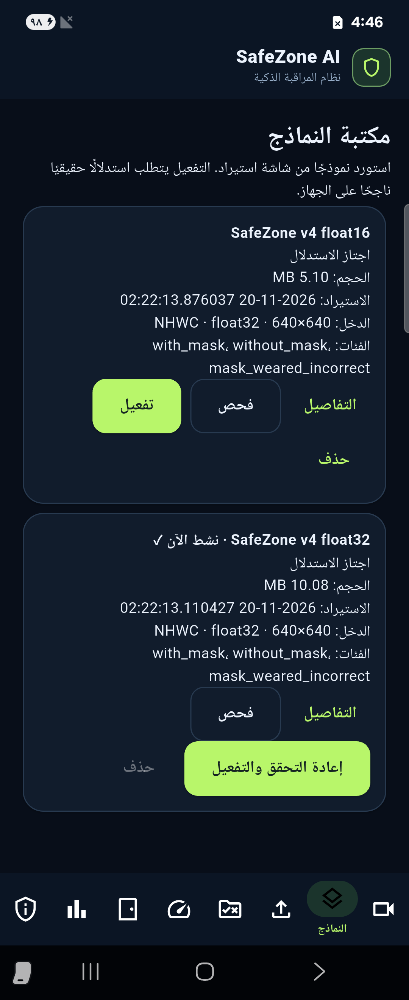
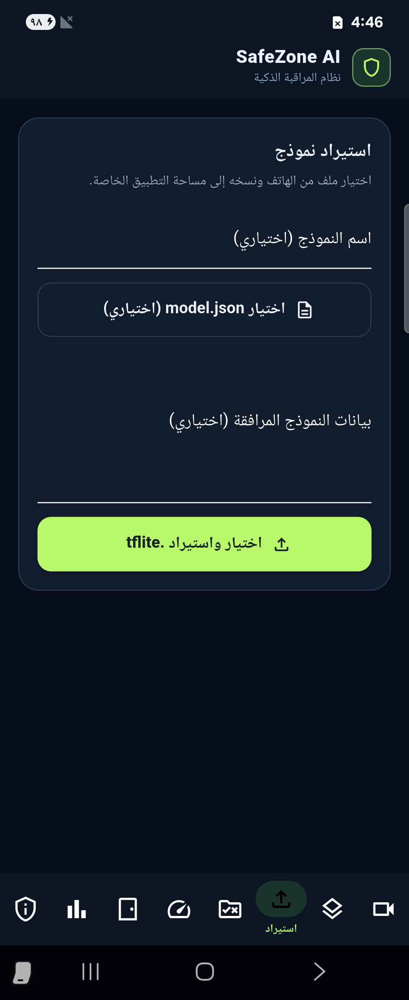
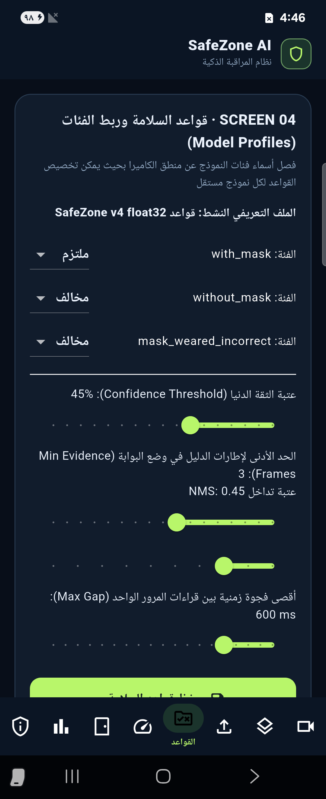

# SafeZoneAI

**A computer-vision prototype for mask-compliance monitoring and safety-event review.**

> **Project status: Prototype — Active Development.** This repository is an early, research-oriented prototype. Final model training and deployment validation are incomplete. Do not use its predictions as the sole basis for access, employment, or safety decisions.

SafeZoneAI explores how camera-based PPE observations can be converted into reviewable events, with a local dashboard and an offline-first Android app. The current implemented scope focuses on face-mask categories; other PPE such as helmets is planned work and is not represented as a validated feature here.

## The problem

Manual PPE checks at entrances can be inconsistent and hard to summarize. SafeZoneAI prototypes a workflow that observes camera frames, labels mask status, waits for stable evidence, and records a minimal event for a human operator to review. It does not identify people, verify a physical door crossing, or replace workplace safety procedures.

## How it works

1. A camera or video source supplies frames to the Python prototype.
2. An Ultralytics YOLO detector proposes `with_mask`, `without_mask`, and `mask_weared_incorrect` boxes.
3. Filtering and temporal evidence logic can mark an observation compliant, a violation candidate, or review/unknown. Uncertain cases should remain reviewable.
4. SQLite stores event metadata; the local web dashboard summarizes counts and recent events.
5. The Flutter Android app provides camera monitoring, event/statistics screens, safety profiles, and a model library. Its model import flow supports dynamically managed LiteRT/TFLite models; no model binary is bundled in this public snapshot.

## Architecture

```text
Camera / video
      |
      v
Python YOLO mask detector ---> temporal / gate logic ---> SQLite event store
                                                          |
                                                          +--> local dashboard

Android camera ---> Flutter UI ---> replaceable LiteRT inference engine
                                      |                     |
                                      +--> local SQLite     +--> imported model files
```

Python code is in [`src/`](src/). The Flutter project is in [`mobile_app/`](mobile_app/). Training and alignment references are in [`training/`](training/); evaluation snapshots are in [`evaluation/`](evaluation/).

## Screenshots

These are real application UI screenshots from the mobile prototype. They show model management and app flows, not independently validated detection performance.

| Model library | Import model | Safety profiles |
|---|---|---|
|  |  |  |

More UI captures are in [`screenshots/`](screenshots/).

## Actual evaluation record

The latest available baseline is **not a success claim**. On the locally prepared R2PPE V7.1 validation split, the archived `best_mask_v4` baseline recorded precision **0.00130**, recall **0.00270**, mAP50 **0.000194**, and mAP50–95 **0.000027**. An alternate `yolo26n` baseline recorded mAP50 **0.000514**. These near-zero results indicate unresolved incompatibility between the checkpoint's box definition and the prepared labels and/or label-quality problems. The reserved test split was not used. A one-epoch smoke run reached mAP50 **0.0148** and is not a completed training run.

Older checkpoint records reported roughly 0.85 validation mAP50 on a different historical setup. That result is not directly comparable to the V7.1 baseline and is not an independent deployment evaluation. See [`evaluation/RESULTS.md`](evaluation/RESULTS.md) and the supplied plots for context. No final training, accuracy target, or real-world performance is claimed.

## Setup and use

### Python prototype

Use Python 3.10 or newer in a clean virtual environment. From the repository root:

```bash
python -m venv .venv
# Windows: .venv\Scripts\activate
# macOS/Linux: source .venv/bin/activate
python -m pip install -r requirements.txt
```

Model weights are deliberately not included because redistribution rights for the trained checkpoint and exported mobile models could not be confirmed. Obtain or train a model for which you have redistribution/use rights, then place it at `models/best_mask_v4.pt` (or pass another model path). Example commands:

```bash
python src/mask_live_v6.py --source 0 --model models/best_mask_v4.pt --database demo/safezone.db
python src/dashboard.py --database demo/safezone.db --port 8501
python src/gate_mode_v1.py --source 0 --model models/best_mask_v4.pt --database demo/safezone.db
```

The dashboard binds to localhost by default. Camera access and model compatibility depend on the local environment. The scripts use relative paths in these examples; pass paths relative to the repository root.

### Android app

Install Flutter and the Android SDK using their official installation instructions, then:

```bash
cd mobile_app
flutter pub get
flutter run
```

The app can import a compatible model through its model-library screen. Review [`mobile_app/docs/MODEL_CONTRACT.md`](mobile_app/docs/MODEL_CONTRACT.md) and [`mobile_app/docs/RUN_AND_DEPLOYMENT_GUIDE_AR.md`](mobile_app/docs/RUN_AND_DEPLOYMENT_GUIDE_AR.md) before importing a model or building a release. Release signing keys are not included.

### Training and data preparation

Training is not complete. The notebooks in [`training/`](training/) have notebook outputs removed for privacy and size. They are references, not a turnkey run: source data, environment setup, and dataset rights must be handled separately. See [`datasets/README.md`](datasets/README.md), [`docs/R2PPE_ALIGNMENT.md`](docs/R2PPE_ALIGNMENT.md), and [`evaluation/RESULTS.md`](evaluation/RESULTS.md). Do not treat the derived R2PPE V7.1 set as training-approved; its label review found material semantic errors and the validation baseline is near zero.

## Data sources and licensing

No source datasets are included. The R2PPE research paper describes CC BY 4.0 subject to third-party exceptions, while its official repository code is GPL-3.0. Confirm rights for the exact source assets before downloading, modifying, or redistributing them. Other local PPE dataset archives had incomplete or unclear license records and are not redistributed. See [`datasets/README.md`](datasets/README.md) and [`docs/THIRD_PARTY_NOTICES.md`](docs/THIRD_PARTY_NOTICES.md).

No project-wide license is assigned in this prototype snapshot. Do not assume that every project file is licensed for reuse; review the third-party notices and obtain permission where needed.

## Roadmap

- Re-review source annotations and model/label box conventions; establish a trustworthy held-out evaluation.
- Complete and document mask-model training only after dataset and labels are approved.
- Validate mobile inference and performance on supported Android hardware.
- Extend the PPE taxonomy to helmets, eye protection, and other equipment after suitable licensed data and evaluation are available.
- Improve deployment, monitoring, and human-review workflows.

## Project state

**Prototype — Active Development.** This snapshot contains working prototype code, mobile source, historical experiment evidence, and setup guidance. It does not contain a cleared model binary, large datasets, or a completed final training result.

See [`README_AR.md`](README_AR.md) for the Arabic overview.
