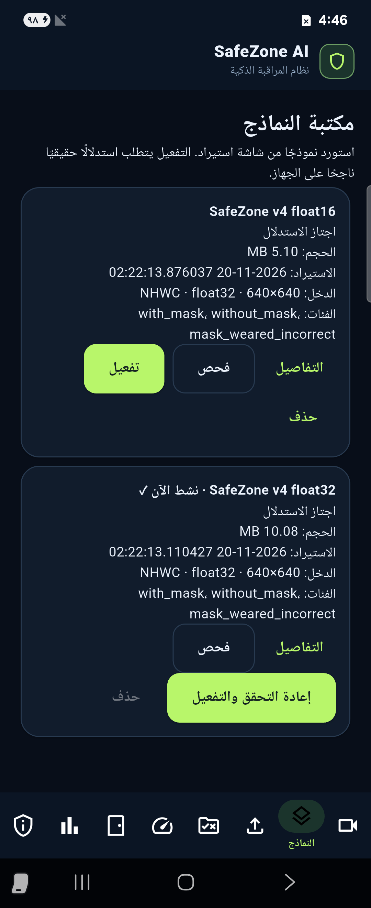
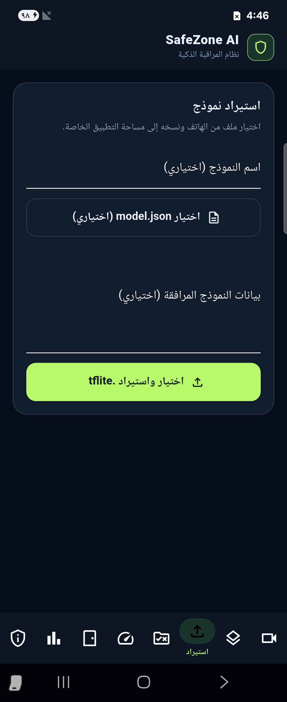
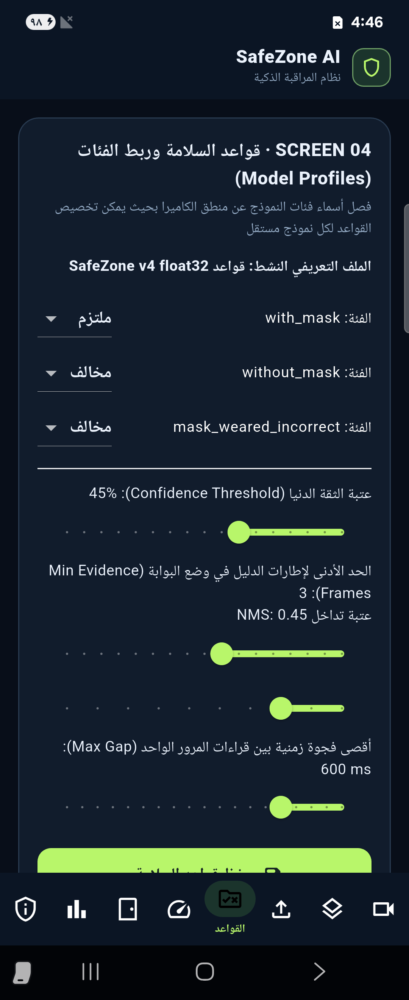

# SafeZoneAI

**نموذج أولي للرؤية الحاسوبية لمراقبة الالتزام بالكمامات ومراجعة أحداث السلامة.**

> **حالة المشروع: Prototype — Active Development.** المشروع نموذج أولي بحثي. لم يكتمل التدريب النهائي أو التحقق قبل النشر. لا تستخدم تنبؤاته وحدها لاتخاذ قرارات دخول أو توظيف أو سلامة.

يستكشف SafeZoneAI تحويل ملاحظات معدات الوقاية من الكاميرا إلى أحداث قابلة للمراجعة، مع لوحة تحكم محلية وتطبيق Android يعمل دون اتصال. يركز النطاق الحالي على حالات الكمامة؛ أما الخوذة وبقية المعدات فهي خطة مستقبلية وليست ميزة معتمدة هنا.

## المشكلة والهدف

قد تكون المراجعة اليدوية عند المداخل غير متسقة ويصعب تلخيصها. يختبر SafeZoneAI سير عمل يلتقط إطارات الكاميرا، ويصنف حالة الكمامة، وينتظر ثبات الأدلة، ثم يسجل حدثاً مختصراً لمراجعته بشرياً. لا يتعرف النظام على هوية الأشخاص، ولا يثبت عبورهم من بوابة فعلية، ولا يحل محل إجراءات السلامة.

## آلية العمل

1. يقرأ نموذج Python إطارات من كاميرا أو فيديو.
2. يقترح كاشف Ultralytics YOLO صناديق للفئات `with_mask` و`without_mask` و`mask_weared_incorrect`.
3. تطبق قواعد التصفية والاستقرار الزمني لتصنيف الملاحظة إلى ملتزم أو حالة تستدعي الانتباه أو مراجعة/غير مؤكدة.
4. تحفظ SQLite بيانات الحدث، وتعرض لوحة محلية الملخصات والأحداث الأخيرة.
5. يوفر تطبيق Flutter Android شاشات الكاميرا والإحصاءات وملفات السلامة ومكتبة نماذج ديناميكية عبر LiteRT/TFLite. لا يتضمن هذا الإصدار العام ملف نموذج ثنائياً.

## المعمارية

```text
كاميرا / فيديو
      |
      v
كاشف الكمامات YOLO ---> منطق الثبات / البوابة ---> SQLite
                                                    |
                                                    +--> لوحة تحكم محلية

كاميرا Android ---> Flutter ---> محرك LiteRT قابل للاستبدال
                                  |                 |
                                  +--> SQLite محلي  +--> ملفات نماذج مستوردة
```

يوجد كود Python في [`src/`](src/)، ومشروع Flutter في [`mobile_app/`](mobile_app/)، ومراجع التدريب ومحاذاة الإطارات في [`training/`](training/)، ونتائج التقييم في [`evaluation/`](evaluation/).

## صور التطبيق

الصور التالية لواجهات حقيقية من نموذج تطبيق الهاتف، وتعرض إدارة النماذج وتدفقات الاستخدام. لا تمثل قياساً مستقلاً لأداء الكشف.

| مكتبة النماذج | استيراد نموذج | ملفات السلامة |
|---|---|---|
|  |  |  |

صور واجهات أخرى في [`screenshots/`](screenshots/).

## نتائج التجارب الفعلية

أحدث خط أساس متوفر **لا يثبت نجاح النموذج**. على مجموعة التحقق R2PPE V7.1 المحضرة محلياً، سجل خط الأساس المؤرشف `best_mask_v4` قيمة precision **0.00130** وrecall **0.00270** وmAP50 **0.000194** وmAP50–95 **0.000027**. سجل البديل `yolo26n` قيمة mAP50 مقدارها **0.000514**. النتائج القريبة من الصفر تكشف مشكلة غير محلولة في توافق تعريف الصناديق بين النموذج والملصقات و/أو جودة الوسوم. لم تستخدم مجموعة الاختبار المحجوزة. بلغ تشغيل تجريبي لعصر واحد mAP50 **0.0148**، وهذا ليس تدريباً مكتملاً.

سجلت قياسات تاريخية أقدم للنموذج قيمة تحقق تقارب 0.85 mAP50 ضمن إعداد مختلف. لا يصح مقارنتها مباشرة بخط أساس V7.1، ولا تمثل تقييماً مستقلاً للنشر. راجع [`evaluation/RESULTS.md`](evaluation/RESULTS.md) والرسوم. لا ندعي اكتمال التدريب أو بلوغ دقة محددة أو أداءً ميدانياً مثبتاً.

## التثبيت والتشغيل

### نموذج Python

استخدم Python 3.10 أو أحدث داخل بيئة افتراضية جديدة، من جذر المستودع:

```bash
python -m venv .venv
# Windows: .venv\Scripts\activate
# macOS/Linux: source .venv/bin/activate
python -m pip install -r requirements.txt
```

لم نرفق الأوزان لأن صلاحية إعادة توزيع النموذج المدرب والنماذج المحمولة لم يتسن تأكيدها. استخدم نموذجاً تملك حق استخدامه وإعادة توزيعه، وضعه في `models/best_mask_v4.pt` أو مرر مساراً آخر:

```bash
python src/mask_live_v6.py --source 0 --model models/best_mask_v4.pt --database demo/safezone.db
python src/dashboard.py --database demo/safezone.db --port 8501
python src/gate_mode_v1.py --source 0 --model models/best_mask_v4.pt --database demo/safezone.db
```

تعمل لوحة التحكم على localhost افتراضياً. يعتمد الوصول إلى الكاميرا وتوافق النموذج على البيئة المحلية. الأمثلة تستخدم مسارات نسبية من جذر المشروع.

### تطبيق Android

ثبّت Flutter وAndroid SDK وفق تعليماتهما الرسمية، ثم:

```bash
cd mobile_app
flutter pub get
flutter run
```

يمكن استيراد نموذج متوافق من شاشة مكتبة النماذج. راجع [`mobile_app/docs/MODEL_CONTRACT.md`](mobile_app/docs/MODEL_CONTRACT.md) و[`mobile_app/docs/RUN_AND_DEPLOYMENT_GUIDE_AR.md`](mobile_app/docs/RUN_AND_DEPLOYMENT_GUIDE_AR.md). لم نرفق مفاتيح توقيع الإصدار.

### التدريب وتجهيز البيانات

لم يكتمل التدريب. أزلت مخرجات الدفاتر قبل إدراجها لحماية الخصوصية وتقليل الحجم. الدفاتر مراجع وليست تشغيلات جاهزة؛ يجب تجهيز البيانات والبيئة والتأكد من الحقوق بشكل مستقل. راجع [`datasets/README.md`](datasets/README.md) و[`docs/R2PPE_ALIGNMENT.md`](docs/R2PPE_ALIGNMENT.md) و[`evaluation/RESULTS.md`](evaluation/RESULTS.md). لا تعتبر مجموعة R2PPE V7.1 مشتقة معتمدة للتدريب؛ فقد أظهرت مراجعة الملصقات أخطاء دلالية مهمة وكانت نتائج التحقق قريبة من الصفر.

## البيانات والتراخيص

لم نرفق أي مجموعة بيانات. تصف ورقة R2PPE البحثية ترخيص CC BY 4.0 مع استثناءات محتملة لمحتوى أطراف أخرى، بينما كود المستودع الرسمي GPL-3.0. تحقق من حقوق الملفات الأصلية المحددة قبل تنزيلها أو تعديلها أو إعادة توزيعها. سجلات تراخيص مجموعات PPE المحلية الأخرى غير مكتملة أو غير واضحة، لذلك لم نرفقها. التفاصيل في [`datasets/README.md`](datasets/README.md) و[`docs/THIRD_PARTY_NOTICES.md`](docs/THIRD_PARTY_NOTICES.md).

لا يتضمن هذا النموذج الأولي ترخيصاً عاماً موحداً للمشروع. لا تفترض أن جميع الملفات مرخصة لإعادة الاستخدام؛ راجع إشعارات الأطراف الأخرى واستحصل على الأذونات اللازمة.

## الخطة المستقبلية

- مراجعة الوسوم وتعريفات صناديق الكشف، ثم إعداد تقييم محجوز موثوق.
- إكمال التدريب وتوثيقه بعد اعتماد البيانات والوسوم فقط.
- التحقق من الاستدلال على Android والأداء على أجهزة مدعومة.
- توسيع الفئات لتشمل الخوذ وواقيات العين وغيرها بعد توفر بيانات مرخصة وتقييم مناسب.
- تحسين النشر والمراقبة وآلية المراجعة البشرية.

## حالة المشروع

**Prototype — Active Development.** يتضمن هذا الإصدار كوداً أولياً ومصدر تطبيق الهاتف وأدلة تجارب سابقة وإرشادات تشغيل. لا يتضمن نموذجاً ثنائياً مصرحاً بإعادة توزيعه، أو بيانات ضخمة، أو نتيجة تدريب نهائية مكتملة.
